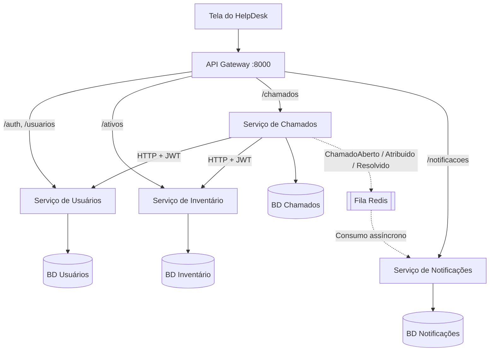

# HelpDesk TI · Arquitetura em Microsserviços

Sistema de chamados de TI refatorado de um **monólito** para uma **arquitetura distribuída em microsserviços**, mantendo todas as funcionalidades, regras de SLA, fluxo de atendimento e controles de segurança originais.

---

## Arquitetura da solução



### Estrutura do repositório

```text
helpdesk-microsservicos-andressa/
├── gateway/                # API Gateway (porta 8000), frontend e health check agregado
├── servico-usuarios/       # Autenticação JWT (/auth), CRUD de usuários e banco próprio
├── servico-inventario/     # Gestão de ativos de TI (/ativos) e banco próprio
├── servico-chamados/       # Chamados, SLA, comentários, chamadas HTTP e eventos Redis
├── servico-notificacoes/   # Consumidor assíncrono de eventos e consulta de avisos
├── .github/workflows/      # Pipeline de CI rodando pytest isolado por serviço
├── docker-compose.yml      # Orquestração completa dos contêineres, redes e volumes
└── .env.example            # Modelo de variáveis de ambiente
```

---

## Decisões arquiteturais

1. **Separação de domínios e bancos isolados (*Database per Service*):** cada microsserviço possui projeto FastAPI, contêiner e banco SQLite próprios em volume Docker separado (`dados_usuarios`, `dados_inventario`, `dados_chamados`, `dados_notificacoes`), sem chaves estrangeiras entre serviços.
2. **Comunicação HTTP com resiliência:** para validar equipamentos e técnicos, o `servico-chamados` consulta `servico-inventario` e `servico-usuarios` pela rede interna do Docker via `httpx` com `timeout` configurado (`3.0s`) e repasse do cabeçalho `Authorization`. Caso um serviço dependente caia, `chamados` responde com **HTTP 503** de forma controlada, sem travar o sistema.
3. **API Gateway como ponto único de entrada:** apenas o `gateway` expõe a porta `127.0.0.1:8000` para o host. Todos os microsserviços e o Redis ficam isolados na rede interna do Docker. Além de servir a tela e rotear requisições, o gateway agrega o status de saúde de todos os serviços em `GET /saude`.
4. **Segurança descentralizada com JWT:** o login permanece centralizado em `servico-usuarios`, mas todos os microsserviços validam localmente a assinatura, emissor e expiração do token JWT usando o segredo compartilhado via `.env` (`JWT_SEGREDO`), preservando as permissões por perfil e os cabeçalhos HTTP de segurança.
5. **Notificações por eventos (Bônus):** ao abrir, atribuir ou resolver um chamado, o `servico-chamados` publica eventos JSON na fila `helpdesk:eventos` do **Redis**, e o `servico-notificacoes` os consome de forma assíncrona. Se `notificacoes` cair, a abertura e atualização de chamados continuam funcionando normalmente.

---

## Como rodar o projeto

1. Copie `.env.example` para `.env` e defina um `JWT_SEGREDO` com pelo menos 32 caracteres:
   ```bash
   cp .env.example .env
   ```
2. Suba todos os serviços com um único comando:
   ```bash
   docker compose up --build
   ```
3. Acesse no navegador:
   - **Tela do HelpDesk:** http://localhost:8000
   - **Saúde dos serviços (Gateway):** http://localhost:8000/saude

### Contas de acesso (senha padrão: `Helpdesk2026`)

| E-mail | Perfil | Permissões |
|---|---|---|
| `admin@empresa.com` | Administrador | Acesso total, inclusive cadastrar usuários |
| `carla@empresa.com` | Técnica | Vê todos os chamados, atribui, resolve e cadastra equipamentos |
| `diego@empresa.com` | Técnico | Mesmo acesso da Carla |
| `ana@empresa.com` | Solicitante | Abre chamados e vê/fecha apenas os próprios |
| `bruno@empresa.com` | Solicitante | Mesmo acesso da Ana |